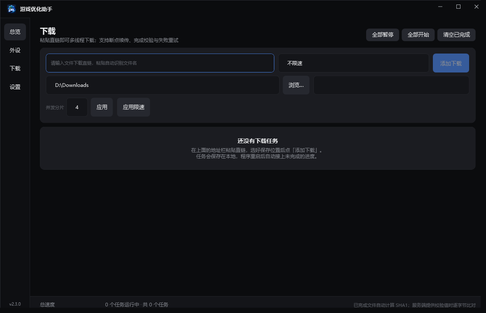
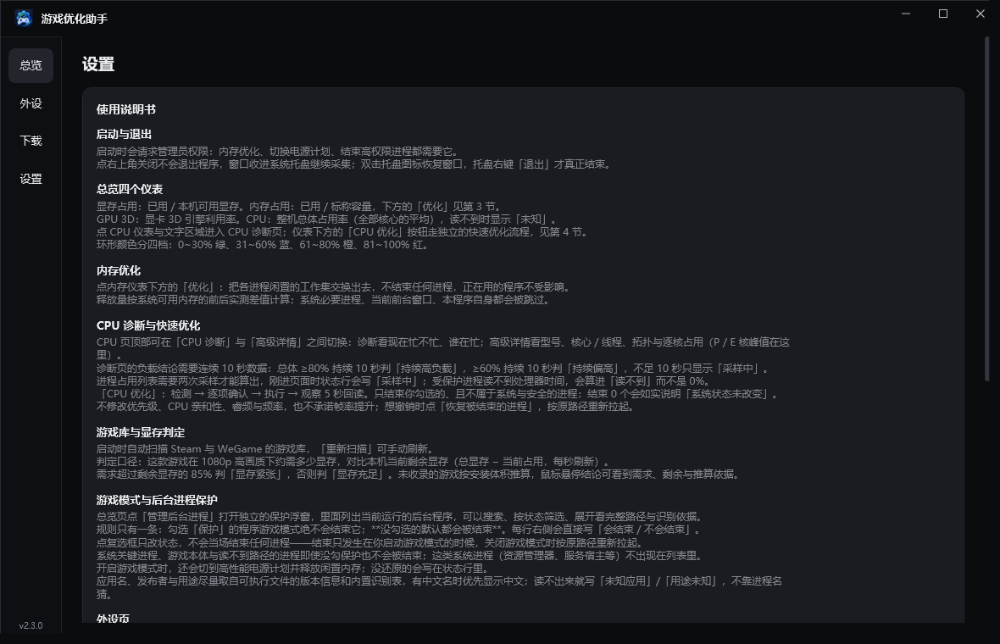

# 游戏优化助手

> **v2.3.0** ｜ Windows 10 / 11 x64 ｜ C# · .NET 8 · WPF ｜ 单文件免安装

[完整文档](docs/README.md) ｜ [已知限制](docs/04-已知限制.md) ｜ [第三方署名](THIRD-PARTY-NOTICES.md)

## 直接下载

**[⬇ 下载 v2.2.2（单文件 exe）](https://github.com/Just-Here-Wyz/GameOptimizer/releases/tag/v2.2.2)**

> 源码已到 **v2.3.0**，安装包尚未发布；当前可下载的仍是 v2.2.2。

Windows 10 / 11 x64 · 69 MB · **自包含，无需安装 .NET 运行时** · 双击即用
（程序声明 `requireAdministrator`，启动会弹 UAC）

| 附件 | 说明 |
|---|---|
| `GameOptimizer-v2.2.2-win-x64.exe` | 单文件自包含，双击运行 |
| `SHA256SUMS.txt` | 校验值，下载后可用 `certutil -hashfile <exe> SHA256` 对比 |

> 未签名证书，首次运行可能触发 SmartScreen「更多信息 → 仍要运行」。

---

面向「显存不足 / 卡顿掉帧」的 Windows 桌面诊断工具。不做「一键提速」的承诺，而是把**显存水位 + 硬件占用 + 外设状态**摆到同一屏，告诉你卡顿到底来自哪里。


<details>
<summary>外设 / 下载 / 设置 页</summary>

**外设**：鼠标、键盘、耳机三类的型号、连接方式与电量。有线自动识别为「有线 · 无需充电」。


**下载**：粘贴直链即可新建任务，多线程分片 + 断点续传 + SHA1 校验 + 全局限速。



**设置**：九节使用说明书，界面里的解释文字不再散落在各页。



</details>

## 能做什么

| 能力 | 状态 |
|---|---|
| 实时监控显存 / 内存 / GPU / **CPU P 核峰值** | ✅ 百分比仪表盘，四档配色；有大小核的机器上只统计性能核，避免被后台挤满小核误报 |
| **一键释放闲置内存** | ✅ 内存仪表旁「优化」按钮；**不结束任何进程**；释放量以系统可用内存实测为准 |
| 外设型号与剩余电量 | ✅ 鼠标 / 键盘 / 耳机，有线自动识别；**VXE/ATK 鼠标走 Compx 私有协议实时读电量** |
| 自动扫描 Steam 与 WeGame 游戏库 | ✅ 剔除壁纸等非游戏 |
| 按游戏判断显存是否充足 | ✅ 按每款游戏的正常需求对比**本机实时剩余显存**，每秒重算 |
| 游戏模式（电源 / 结束后台 / 内存） | ✅ 全部可回滚；必要进程自动保护；**关闭时自动恢复被结束的进程** |
| **CPU 详情页** | ✅ 点 CPU 仪表进入：一行结论 + P/E/全局/总 CPU 四项汇总 + 按大小核分组的每核条形图 |
| **系统压力** | ✅ 磁盘吞吐（贴图流式加载是否卡在磁盘）与总 CPU 同在详情页 |
| **下载器** | ✅ 侧边栏「下载」页：粘贴直链新建任务，多线程分片、断点续传、SHA1 校验、失败重试、全局限速，任务列表本地持久化 |
| 系统托盘常驻 | ✅ 关窗口收进托盘后台运行，双击托盘图标恢复，托盘菜单退出 |

## 快速开始

```powershell
dotnet build
dotnet run --project src/GameOptimizer.App
```

> v2.0.0 起程序声明 `requireAdministrator`，启动会弹 UAC。
> 内存清理、电源计划、结束高权限进程都需要管理员权限。

## 界面

- **总览**：显存 / 内存 / GPU 3D / **CPU P 核峰值** 四个环形仪表，按占用率着色
  - 0~30% 绿 · 31~60% 蓝 · 61~80% 橙 · 81~100% 红
  - **内存仪表下方有「优化」按钮**：一键释放闲置工作集，执行中 / 成功 / 失败三态可见
  - 「开启游戏模式」旁有**白名单设置**按键，点击展开带应用图标的白名单面板
  - 开启后按钮变为红色「关闭游戏模式」，关闭时自动恢复被结束的进程
- **CPU 详情**：点 CPU 仪表进入，看每颗核在忙什么
  - 顶部一行结论直接说要不要担心（如「小核被后台挤满，跑游戏的大核仍空闲」）
  - 四项汇总：P 核峰值 / E 核峰值 / 全局峰值 / 总 CPU，并解释各自口径
  - 按大小核分组的每核条形图，占用最高的那颗放大着色
- **外设**：鼠标、键盘、耳机三类的型号与剩余电量；有线连接显示「有线」并用蓝色主题；
  不显示笔记本自带键盘；**VXE/ATK（Compx）鼠标通过私有 HID 协议实时读取电量**
- **下载**：粘贴直链新建任务；任务按「正在下载 / 下载失败 / 已完成」分组，
  卡片显示大小、实时速度、剩余时间与 SHA1 校验结论；底部一条全局统计
  - 断点续传：程序重启后自动接上上次未完成的进度；服务端不支持 Range 时退化为单线程从头下
  - 校验不通过先用分片哈希定位坏片、只重下坏片；定位不到才整份重下
  - 服务端没给校验值时如实标注「未校验」，不假装通过
- **设置**：版本号、采集状态、显存预算来源，以及**九节使用说明书**（说明文字不再散落在各页）

窗口为无系统白边的自绘窗体（深色标题栏 + 1px 描边），行为与普通窗口一致：可拖动、双击最大化、四边缩放。
**点关闭按钮不会退出程序**，而是收进系统托盘继续后台采集；托盘图标双击恢复窗口，右键菜单「退出」才真正结束。

## 工程概况

| 项 | 数据 |
|---|---|
| 开发周期 | 2026-10-19 ~ 10-22，**4 天完成主体功能**（36 次提交） |
| 提交与版本 | 累计 **40 次提交**、**14 个版本 tag**（v0.5.0 → v2.2.2） |
| 代码量 | C# **18,682 行 / 112 个文件**（src + tests，不含生成代码）+ XAML 1,330 行 |
| 测试 | **584 个 xUnit 用例**，只引用 `GameOptimizer.Core`，不引入 UI 依赖；少量用例会读真实系统（进程列表 / 电源计划 / 性能计数器）做一致性校验 |
| 分层 | `Core` 无 UI 依赖、可单测；`App` 只做 WPF 呈现与交互 |

## 怎么做的（AI 协作说明）

这个项目是**个人独立立项**：需求拆解、技术选型、模块划分、验收标准和代码评审由本人完成；
**具体编码与测试用例的落地过程大量借助 AI Agent**——多轮对话生成 → 我逐块审阅取舍 → 编译与用例回归验证。

过程中 AI 暴露了两个系统性缺陷，值得单独记一笔：

- **伪修复**：反复给出「同一数据源取两次再比较」的写法，看起来像修复，实际检查的是同一个值；
- **多真源不收敛**：同一份状态被三处代码各自缓存，改一处另两处不跟着变。

最终沉淀成四条协作规矩（改前先定位、一次只改一个因果链、修完必须回读验证、禁止同源比对）。
完整复盘见 [docs/07-AI协作复盘.md](docs/07-AI协作复盘.md)。

## 文档

| 文档 | 内容 |
|---|---|
| [项目总览](docs/00-项目总览.md) | **接手必读**：定位、技术栈、核心机制、硬约定、常见改动、已知坑 |
| [架构与模块](docs/01-架构与模块.md) | 分层、数据流、各模块职责 |
| [功能清单](docs/02-功能清单.md) | 逐项功能状态与说明 |
| [版本规则](docs/03-版本规则.md) | 版本号约定、发布流程 |
| [已知限制](docs/04-已知限制.md) | **明确做不到的事**，先看这个 |
| [开发指南](docs/05-开发指南.md) | 构建、调试、踩过的坑 |
| [变更记录](docs/06-变更记录.md) | 演进历史与修过的真实 bug |
| [AI 协作复盘](docs/07-AI协作复盘.md) | 4 天怎么和 AI 把这个项目做出来、它在哪儿坑过我 |

## 项目结构

```
src/GameOptimizer.Core     采集、判定、外设识别、游戏模式动作（无 UI 依赖，可单测）
src/GameOptimizer.App      WPF 界面（app.manifest 声明 requireAdministrator）
tests/GameOptimizer.Tests  xUnit 用例，仅引用 Core
tools/                     运维脚本
docs/                      项目文档（01~07 + 界面截图）
publish/                   发布产物（已 gitignore，不入库）
```

### 文档里的截图怎么来的

`GameOptimizer.App.dll --render <输出目录> [页面名,...]` 会离屏渲染真实 XAML 并输出 PNG，
页面名可取 `home` / `peripherals` / `download` / `settings` / `cpu`。它不建托盘、不碰游戏模式，
下载页用独立的临时任务表——所以截图里不会带上任何一台机器上的真实下载记录。

## 测试

```powershell
dotnet test
```

本机实测：**584 个用例全部通过，3 秒**，进程正常退出（`-c Release`）。

> 其中一支用例会去本机真实 HID 设备读 VXE 鼠标电量。这类设备 I/O **一律带超时**
> （见下面的「不可观测的不报结论」），所以没有外设时它会很快返回「未知」而不是挂住——
> 早期版本没有超时，`dotnet test` 跑完用例后进程退不出去，就是这里的问题。

## 设计原则

- **失败必须可见**：会改系统的操作在 Apply 后回读确认；回滚失败明确报错，绝不静默显示「已还原」
- **不可观测的不报结论**：读不到电量就显示「未知」；内存释放量以系统可用内存实测为准，
  不拿逐进程合计（会因共享页面重复计数虚高数倍）冒充
- **不做静默安装**：不注入游戏进程、不装驱动、不改系统服务
- **可能卡住的调用必须带超时**：读设备、读计数器、起进程都不允许「一直等」。
  外设电量读取曾经因为同步 `ReadFile` 无超时，在设备不该答时把整个程序挂死；
  现在统一用 overlapped I/O + 显式超时，等不到就当读不到

## 合规、署名与边界

完整说明见 [THIRD-PARTY-NOTICES.md](THIRD-PARTY-NOTICES.md)，要点：

- **下载器**参考了 [PCL（Plain Craft Launcher，作者 龙腾猫跃）](https://github.com/Meloong-Git/PCL)
  的交互与能力。PCL 采用自定义的《PCL 存储库合理使用指南》，本项目为通用直链下载器、
  与 PCL 的实质功能（Minecraft 启动与资源下载）无重叠，按「轻度使用」条款**署名**且不与 PCL 混淆。
  未复制、未反编译其任何源码。
- **VXE/ATK 鼠标电量**：通信格式由分析厂商网页驱动（`hub.atk.pro`，浏览器 WebHID）与设备间的
  公开报文得到，仅读取、不写入、不绕过授权，组包与解析为独立实现。厂商名称仅作描述性使用，
  不代表任何官方授权或背书。
- **主动边界**：不注入游戏进程、不 Hook 图形 API、不读写游戏内存、不装驱动、不伪造设备身份。

## 许可

代码 [MIT](LICENSE) · 文档 CC BY 4.0 · Copyright © 2026 王亚峥
