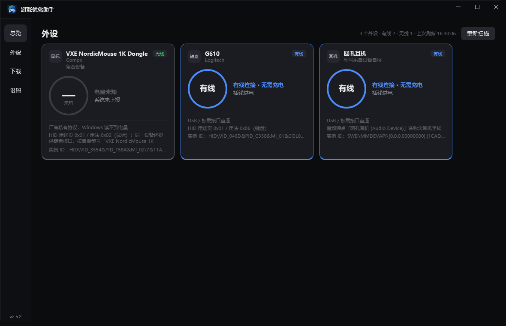

# 游戏优化助手

> 当前版本 **v2.2.2** ｜ Windows 10/11 ｜ [完整文档](docs/README.md)

面向「显存不足 / 卡顿掉帧」的 Windows 桌面诊断工具。不做「一键提速」的承诺，而是把**显存水位 + 硬件占用 + 外设状态**摆到同一屏，告诉你卡顿到底来自哪里。


<details>
<summary>外设页</summary>



</details>

## 能做什么

| 能力 | 状态 |
|---|---|
| 实时监控显存 / 内存 / GPU / **CPU P 核峰值** | ✅ 百分比仪表盘，四档配色；有大小核的机器上只统计性能核，避免被后台挤满小核误报 |
| **一键释放闲置内存** | ✅ 内存仪表旁「优化」按钮；**不结束任何进程**；释放量以系统可用内存实测为准 |
| 外设型号与剩余电量 | ✅ 鼠标 / 键盘 / 耳机，有线自动识别；**VXE/ATK 鼠标走 Compx 私有协议实时读电量** |
| 自动扫描 Steam 与 WeGame 游戏库 | ✅ 剔除壁纸等非游戏 |
| 按游戏判断显存是否充足 | ✅ 按每款游戏的正常需求对比**本机实时剩余显存**，每秒重算 |
| 游戏模式（电源 / 结束后台 / 内存） | ✅ 全部可回滚；必要进程自动保护；**关闭时自动恢复被结束的进程** |
| **CPU 详情页** | ✅ 点 CPU 仪表进入：一行结论 + P/E/全局/总 CPU 四项汇总 + 按大小核分组的每核条形图 |
| **系统压力** | ✅ 磁盘吞吐（贴图流式加载是否卡在磁盘）与总 CPU 同在详情页 |
| **下载器** | ✅ 侧边栏「下载」页：粘贴直链新建任务，多线程分片、断点续传、SHA1 校验、失败重试、全局限速，任务列表本地持久化 |
| 系统托盘常驻 | ✅ 关窗口收进托盘后台运行，双击托盘图标恢复，托盘菜单退出 |

## 快速开始

```powershell
dotnet build
dotnet run --project src/GameOptimizer.App
```

> v2.0.0 起程序声明 `requireAdministrator`，启动会弹 UAC。
> 内存清理、电源计划、结束高权限进程都需要管理员权限。

## 界面

- **总览**：显存 / 内存 / GPU 3D / **CPU P 核峰值** 四个环形仪表，按占用率着色
  - 0~30% 绿 · 31~60% 蓝 · 61~80% 橙 · 81~100% 红
  - **内存仪表下方有「优化」按钮**：一键释放闲置工作集，执行中 / 成功 / 失败三态可见
  - 「开启游戏模式」旁有**白名单设置**按键，点击展开带应用图标的白名单面板
  - 开启后按钮变为红色「关闭游戏模式」，关闭时自动恢复被结束的进程
- **CPU 详情**：点 CPU 仪表进入，看每颗核在忙什么
  - 顶部一行结论直接说要不要担心（如「小核被后台挤满，跑游戏的大核仍空闲」）
  - 四项汇总：P 核峰值 / E 核峰值 / 全局峰值 / 总 CPU，并解释各自口径
  - 按大小核分组的每核条形图，占用最高的那颗放大着色
- **外设**：鼠标、键盘、耳机三类的型号与剩余电量；有线连接显示「有线」并用蓝色主题；
  不显示笔记本自带键盘；**VXE/ATK（Compx）鼠标通过私有 HID 协议实时读取电量**
- **下载**：粘贴直链新建任务；任务按「正在下载 / 下载失败 / 已完成」分组，
  卡片显示大小、实时速度、剩余时间与 SHA1 校验结论；底部一条全局统计
  - 断点续传：程序重启后自动接上上次未完成的进度；服务端不支持 Range 时退化为单线程从头下
  - 校验不通过先用分片哈希定位坏片、只重下坏片；定位不到才整份重下
  - 服务端没给校验值时如实标注「未校验」，不假装通过
- **设置**：版本号、采集状态、显存预算来源，以及**九节使用说明书**（说明文字不再散落在各页）

窗口为无系统白边的自绘窗体（深色标题栏 + 1px 描边），行为与普通窗口一致：可拖动、双击最大化、四边缩放。
**点关闭按钮不会退出程序**，而是收进系统托盘继续后台采集；托盘图标双击恢复窗口，右键菜单「退出」才真正结束。

## 文档

| 文档 | 内容 |
|---|---|
| [架构与模块](docs/01-架构与模块.md) | 分层、数据流、各模块职责 |
| [功能清单](docs/02-功能清单.md) | 逐项功能状态与说明 |
| [版本规则](docs/03-版本规则.md) | 版本号约定、发布流程 |
| [已知限制](docs/04-已知限制.md) | **明确做不到的事**，先看这个 |
| [开发指南](docs/05-开发指南.md) | 构建、调试、踩过的坑 |
| [变更记录](docs/06-变更记录.md) | 演进历史与修过的真实 bug |

## 项目结构

```
src/GameOptimizer.Core     采集、判定、外设识别、游戏模式动作（无 UI 依赖，可单测）
src/GameOptimizer.App      WPF 界面（app.manifest 声明 requireAdministrator）
tests/GameOptimizer.Tests  574 个 xUnit 用例
tools/                     运维脚本
docs/                      项目文档
```

## 测试

```powershell
dotnet test
```

## 设计原则

- **失败必须可见**：会改系统的操作在 Apply 后回读确认；回滚失败明确报错，绝不静默显示「已还原」
- **不可观测的不报结论**：读不到电量就显示「未知」；内存释放量以系统可用内存实测为准，
  不拿逐进程合计（会因共享页面重复计数虚高数倍）冒充
- **不做静默安装**：不注入游戏进程、不装驱动、不改系统服务


