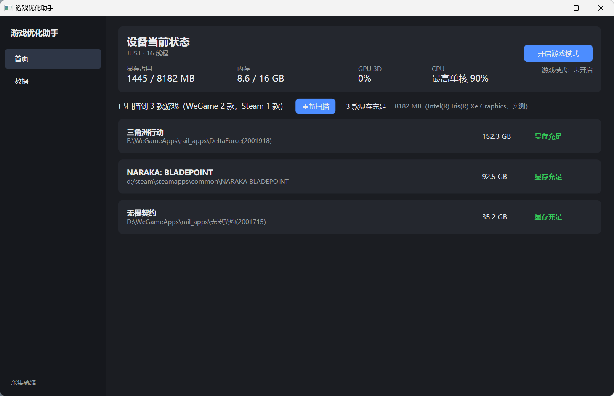
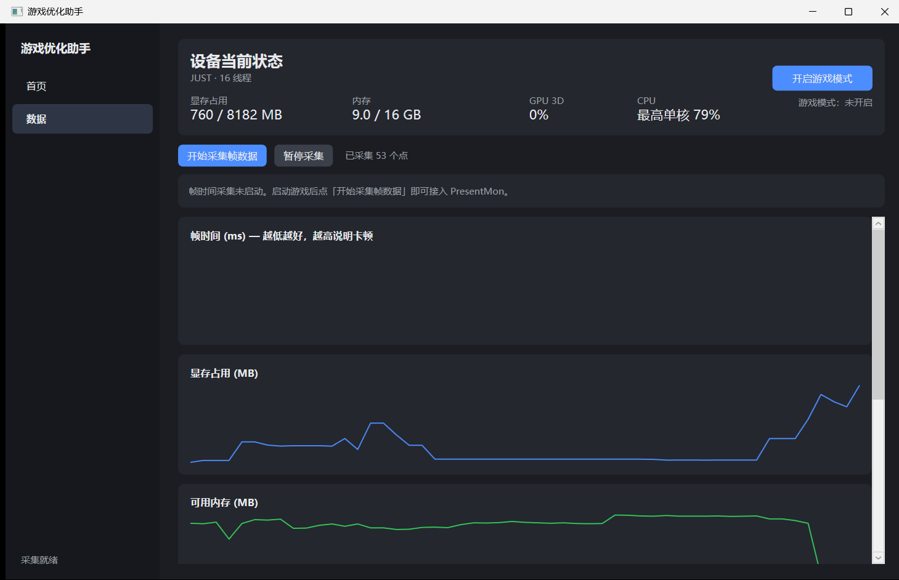

# 游戏优化助手

> 当前版本 **v0.5.0** ｜ Windows 10/11 ｜ [完整文档](docs/README.md)

面向「显存不足 / 卡顿掉帧」的 Windows 桌面诊断工具。不做「一键提速」的承诺，而是把**显存水位 + 帧时间 + 硬件占用**放进同一条时间轴，告诉你卡顿到底来自哪里。



<details>
<summary>数据页</summary>



</details>

## 能做什么

| 能力 | 状态 |
|---|---|
| 实时监控显存 / 内存 / GPU / 逐核 CPU | ✅ 无需任何特权 |
| 自动扫描 Steam 与 WeGame 游戏库 | ✅ 剔除壁纸等非游戏 |
| 按游戏判断显存是否充足 | ✅ 按每款游戏的正常需求对比本机实测显存 |
| 帧时间采集与卡顿归因 | ⚠️ 需要 ETW 权限，见下 |
| 游戏模式（电源 / 显卡 / 后台进程） | ✅ 全部可回滚 |

## 快速开始

```powershell
dotnet build
dotnet run --project src/GameOptimizer.App
```

## 帧时间需要一次性授权

PresentMon 启动 ETW 追踪需要特权。二选一：

**方式 A：直接以管理员身份运行本程序**（每次都要）

**方式 B：加入用户组**（一次性，之后普通权限即可）

```powershell
# 管理员 PowerShell 执行一次
powershell -ExecutionPolicy Bypass -File tools\enable-presentmon-etw.ps1
```

然后**注销并重新登录**（组成员身份需重登生效）。

验证是否成功：

```powershell
powershell -ExecutionPolicy Bypass -File tools\verify-frametime.ps1
```

> `Performance Log Users` 组权限远小于管理员，只允许启动性能追踪会话。

## 文档

| 文档 | 内容 |
|---|---|
| [架构与模块](docs/01-架构与模块.md) | 分层、数据流、各模块职责 |
| [功能清单](docs/02-功能清单.md) | 逐项功能状态与说明 |
| [版本规则](docs/03-版本规则.md) | 版本号约定、发布流程 |
| [已知限制](docs/04-已知限制.md) | **明确做不到的事**，先看这个 |
| [开发指南](docs/05-开发指南.md) | 构建、调试、踩过的坑 |
| [变更记录](docs/06-变更记录.md) | 演进历史与修过的真实 bug |

## 项目结构

```
src/GameOptimizer.Core     采集、判定、归因（无 UI 依赖，可单测）
src/GameOptimizer.App      WPF 界面
tests/GameOptimizer.Tests  272 个 xUnit 用例
tools/                     运维脚本（ETW 授权、链路验证）
docs/                      项目文档
```

## 测试

```powershell
dotnet test
```

## 设计原则

- **失败必须可见**：会改系统的操作在 Apply 后回读确认；回滚失败明确报错，绝不静默显示「已还原」
- **不可观测的不报结论**：没有帧数据时不输出「帧时间平稳」
- **不做静默安装**：不注入游戏进程、不装驱动、不改系统服务
